  

<h1 align="center">🚀 Awesome Unified HR &amp; Talent Management Suite 🚀</h1>

  <strong>A comprehensive curated directory of enterprise HCM suites, core HRMS software, and open-source talent platforms.</strong>

  
  
  
  
  
  
  

  <b>A comprehensive, SEO-optimized curated list of top Unified HR, Human Capital Management (HCM), and Talent Management Suite platforms.</b> 
  Featuring commercial enterprise SaaS vendors ranked by scale, and production-grade self-hosted open-source software ranked by GitHub community adoption.

  🌟 <b>Star this repository if you find it valuable!</b> 🌟

---

## 📑 Table of Contents
- [🌐 Sector Overview & Market Dynamics](#-sector-overview--market-dynamics)
- [🏢 SaaS / Hosted Platforms](#-saas--hosted-platforms)
- [🔓 Open-Source Software](#-open-source-software)
- [📊 Feature Comparison Matrix](#-feature-comparison-matrix)
- [🎯 Key Evaluation Criteria](#-key-evaluation-criteria)
- [💖 Support & Community](#-support--community)
- [📈 Star History](#-star-history)
- [🤝 Contributing](#-contributing)
- [📄 License](#-license)

---

## 🌐 Sector Overview & Market Dynamics

The global **Human Capital Management (HCM)** and **Talent Management Suite** market is estimated at **$25.5 Billion to $27.5 Billion** and is projected to expand to over **$45 Billion to $60 Billion by 2030**, advancing at a compound annual growth rate (CAGR) between **8.5% and 13.5%**. 

The sector is **moderately to highly fragmented**: while mega-cap titans (ADP, Oracle, SAP, Workday) anchor large multinational enterprises with entrenched core payroll and compliance records, no single vendor captures a winner-take-all monopoly. A vibrant ecosystem of mid-market innovators (Rippling, BambooHR, Dayforce) and extensible open-source platforms continually capture market share by prioritizing developer-friendly APIs, employee self-service experience (EX), AI-augmented recruiting pipelines, and lower total cost of ownership (TCO).

---

## 🏢 SaaS / Hosted Platforms

Leading commercial and enterprise cloud-hosted Unified HR and Talent Management Suite solutions, sorted in descending order by enterprise market valuation / company size.

| Platform 🏢 | Enterprise Scale / Valuation 📈 | Starting Tier Pricing 🏷️ | Free Tier / Free Trial Limits ⏱️ | Core Focus / Capabilities 🎯 |
|:---|:---|:---|:---|:---|
| **[Oracle Cloud HCM](https://www.oracle.com/human-capital-management/)** | **~$480B+ Market Cap** *(Oracle Corp)* | **$15.00** per hosted employee/month *(Base HCM Cloud list; modular add-ons like Recruiting ~$8 PEPM extra; $7,500/mo min)* | **No free trial** *(Custom guided enterprise sandbox during RFP/procurement scoping only)* | Unified global enterprise HCM within Oracle Fusion suite covering core HR, workforce planning, payroll, and AI skills ontology. |
| **[SAP SuccessFactors](https://www.sap.com/products/hcm.html)** | **~$280B+ Market Cap** *(SAP SE)* | **$5.00 – $8.00** per user/month *(Core Employee Central entry base; typical full talent suite blends $22–$38 PEPM)* | **30-day guided trial** *(Pre-configured SAP Cloud test environment with simulated organizational demo data)* | Enterprise modular HCM deeply intertwined with SAP S/4HANA ERP, covering global compliance, recruiting, and learning. |
| **[ADP Vantage HCM](https://www.adp.com/what-we-offer/products/adp-vantage-hcm.aspx)** | **~$119.8B Market Cap** *(NASDAQ: ADP)* | **$20.00 – $24.00** per employee/month *(Base enterprise tier; scales to $8–$16 PEPM for mega 5,000+ employee volumes)* | **No free trial** *(Live sales demonstrations and RFP pilot modeling only; no self-serve sandbox)* | Enterprise HR, multinational payroll, benefits administration, and compliance backed by ADP’s global payroll tax engine. |
| **[Workday HCM](https://www.workday.com/en-us/products/human-capital-management.html)** | **~$65B – $70B Market Cap** *(NASDAQ: WDAY)* | **$34.00 – $42.00** per employee/month *(Core HCM base subscription billed annually; full talent suites blend $96–$150+ PEPM)* | **No free trial** *(No self-serve trial; custom production sandbox provided only post enterprise contract scoping)* | Flagship enterprise cloud HCM known for unified architecture, core HR, talent analytics, and continuous planning. |
| **[Rippling](https://www.rippling.com/)** | **$16.8B Valuation** *(Series G; $1B+ ARR)* | **$8.00** per employee/month *(Core Unity HR platform; plus $35/mo base fee; payroll/IT modules add $5–$9 PEPM)* | **No public free trial** *(Full platform is custom quote; startup accelerator offers 6 months free for qualifying funded startups)* | All-in-one compound platform orchestrating HR, automated payroll, benefits, device management, and cloud app identity. |
| **[Dayforce](https://www.dayforce.com/)** | **$12.3B Valuation** *(Thoma Bravo acquisition; $1.8B ARR)* | **$22.00 – $31.00** per employee/month *(Dayforce unified suite base; custom volume and module tiers)* | **No free trial** *(Proof-of-concept environment available upon request for verified enterprise sales prospects)* | Real-time continuous payroll calculation, workforce scheduling, time tracking, and global talent management. |
| **[Zoho People Plus](https://www.zoho.com/peopleplus/)** | **~$12.5B Valuation** *(Zoho Corp; ~$1.5B Revenue)* | **$10.00** per employee/month *(Billed monthly, or $8.00/mo billed annually; standalone Zoho People starts at $1.25/mo)* | **30-day free trial** *(Full enterprise features for unlimited users, no credit card required; standalone People has a forever-free tier up to 5 users)* | Integrated HR suite bundling applicant tracking (Zoho Recruit), attendance, LMS, expense reporting, and connect feeds. |
| **[Paycom](https://www.paycom.com/)** | **~$11.9B Market Cap** *(NYSE: PAYC)* | **$25.00 – $36.00** per employee/month *(Comprehensive HCM suite; payroll-only tier starts around $12–$18 PEPM; one-time setup extra)* | **No free trial** *(Personalized 1-on-1 guided product walk-through and customized sales demo only)* | Single-database HR and payroll system with an employee-driven Beti® automated payroll self-service workflow. |
| **[Cornerstone OnDemand](https://www.cornerstoneondemand.com/)** | **$5.2B Valuation** *(Clearlake Capital; ~$740M ARR)* | **$6.00 – $10.00** per user/month *(Learning & Performance tier; comprehensive Talent Experience suite ranges $15–$25 PEPM)* | **No free trial** *(Guided architectural demo sessions for HR leaders; tailored enterprise evaluation periods)* | Talent experience platform specializing in enterprise learning management (LMS), skills graph, succession, and performance. |
| **[BambooHR](https://www.bamboohr.com/)** | **~$2.5B Valuation** *(Providence Equity; ~$350M ARR)* | **$10.00** per employee/month *(Core Essentials plan; Pro plan at $17 PEPM; flat $250/mo minimum for companies under 25 employees)* | **7-day free trial** *(Full access to applicant tracking, employee records, time off approvals, and self-service onboarding)* | Intuitive, user-friendly HRIS designed specifically for SMBs, featuring ATS workflows, employee directory, and automated PTO tracking. |

---

## 🔓 Open-Source Software

Self-hosted, community-driven, and developer-friendly Unified HR, HRMS, and Talent Management platforms. Sorted in descending order by GitHub stargazer count.

| Project & Repository 📦 | GitHub_Stars ⭐ | Technology Stack 💻 | License 📜 | Best Use Case 💡 |
|:---|:---|:---|:---|:---|
| **[Odoo HR](https://github.com/odoo/odoo)** |  | Python / PostgreSQL / JavaScript | LGPL-3.0 | Complete modular ERP suite featuring full recruitment pipeline, employee directory, leaves, expenses, and appraisal workflows. |
| **[Frappe HR](https://github.com/frappe/hrms)** |  | Python / Frappe Framework / MariaDB | GPL-3.0 | Modern, 100% open-source HR and automated payroll powerhouse with shift rostering, expense claims, tax slabs, and ERPNext integration. |
| **[Ever Gauzy](https://github.com/ever-co/ever-gauzy)** |  | TypeScript / NestJS / Angular / TypeORM | AGPL-3.0 | Full-spectrum business management platform unifying HR, ATS applicant tracking, employee contracts, time tracking, and project budgeting. |
| **[Wukong HRM](https://github.com/WuKongOpenSource/Wukong_HRM)** |  | Java (Spring Boot) / Vue.js / MySQL | Apache-2.0 / Commercial Dual | Enterprise-grade HR suite featuring complete hiring lifecycle, candidate management, onboarding workflows, KPI reviews, and compensation. |
| **[Horilla HRMS](https://github.com/horilla/horilla-hr)** |  | Python / Django / PostgreSQL / SQLite | LGPL-2.1 | Genuinely free, standalone modern HRMS with end-to-end recruitment, biometric attendance, salary rules, leave tracking, and asset management. |
| **[OrangeHRM](https://github.com/orangehrm/orangehrm)** |  | PHP / Symfony / MySQL | GPL-2.0 | Battle-tested, globally recognized open-source HR platform covering core employee records, time tracking, leave administration, and reporting. |
| **[OpenCATS](https://github.com/opencats/OpenCATS)** |  | PHP / MySQL / Apache | GPL-2.0 / Open Source | Dedicated open-source Applicant Tracking System (ATS) and recruitment CRM built specifically for hiring teams, resume parsing, and candidate sourcing. |
| **[IceHrm](https://github.com/gamonoid/icehrm)** |  | PHP / JavaScript / MySQL | Apache-2.0 | Lightweight and straightforward self-hosted HR tool covering employee directory, time card attendance, document management, and basic payroll. |
| **[Sentrifugo](https://github.com/sapplica/sentrifugo)** |  | PHP / Zend Framework / MySQL | GPL-3.0 | Free, feature-rich HRMS featuring appraisal management, candidate background checks, exit interviews, time off, and leave policies. |
| **[MintHCM](https://github.com/minthcm/minthcm)** |  | PHP / SuiteCRM Base / ElasticSearch | AGPL-3.0 | "CRM reinvented for HR" — focuses on talent skills inventory, employee relationship tracking, recruitment, onboarding, and native mobile apps. |
| **[Urlaubsverwaltung](https://github.com/urlaubsverwaltung/urlaubsverwaltung)** |  | Java / Spring Boot / Thymeleaf | Apache-2.0 | Specialized self-hosted leave and absence management system handling vacation allowances, sick leave documentation, and overtime tracking. |
| **[Headcount](https://github.com/bluewave-labs/Headcount)** |  | JavaScript / Node.js / React | AGPL-3.0 | Modern, minimalist headcount and employee directory system with self-service profiles, department org charts, and PTO management. |
| **[iBizEHR](https://github.com/iBizLab/iBizEHR)** |  | Java / Spring Boot / Vue.js | MIT | Modular, model-driven architecture HR platform for enterprises needing 100% MIT-licensed code for local data sovereignty and custom UI generation. |

---

## 📊 Feature Comparison Matrix

| Software Platform 💻 | Deployment 🌐 | Native Payroll 💰 | ATS / Recruiting 👥 | Performance & OKRs 📈 | Learning / LMS 🎓 | Self-Hosted 🏠 |
|:---|:---:|:---:|:---:|:---:|:---:|:---:|
| **Oracle Cloud HCM** | Cloud SaaS | ✅ Comprehensive | ✅ Advanced AI | ✅ Built-in | ✅ Built-in | ❌ |
| **SAP SuccessFactors** | Cloud SaaS | ✅ Modular | ✅ Advanced | ✅ Built-in | ✅ Industry Leader | ❌ |
| **ADP Vantage HCM** | Cloud SaaS | ✅ Native Engine | ✅ Integrated | ✅ Optional Add-on | ✅ Optional Add-on | ❌ |
| **Workday HCM** | Cloud SaaS | ✅ Native Global | ✅ Built-in | ✅ Continuous | ✅ Built-in | ❌ |
| **Rippling** | Cloud SaaS | ✅ Automated | ✅ Integrated ATS | ✅ Built-in | ✅ App LMS | ❌ |
| **Dayforce** | Cloud SaaS | ✅ Continuous | ✅ Built-in | ✅ Built-in | ✅ Optional | ❌ |
| **Zoho People Plus** | Cloud SaaS | ✅ Zoho Payroll | ✅ Zoho Recruit | ✅ Zoho Performance | ✅ Zoho Learn | ❌ |
| **Paycom** | Cloud SaaS | ✅ Beti® Automated | ✅ Built-in | ✅ Built-in | ✅ Built-in | ❌ |
| **Cornerstone OnDemand**| Cloud SaaS | ❌ Integrations | ✅ Included | ✅ Comprehensive | ✅ Enterprise Tier | ❌ |
| **BambooHR** | Cloud SaaS | 🟡 Paid Add-on | ✅ Built-in | 🟡 Paid Add-on | ❌ Third-party | ❌ |
| **Odoo HR** | Hybrid / Self-Host | 🟡 Enterprise App | ✅ Open ATS | ✅ Appraisals | ✅ eLearning App | ✅ |
| **Frappe HR** | Self-Hosted | ✅ Native Free | ✅ Built-in ATS | ✅ Appraisal Cycle | ❌ Extensible | ✅ |
| **Ever Gauzy** | Self-Hosted | 🟡 Time & Rate | ✅ ATS Module | 🟡 Goal Tracking | ❌ Extensible | ✅ |
| **Wukong HRM** | Self-Hosted | ✅ Included | ✅ Built-in ATS | ✅ KPI / OKR | ❌ Extensible | ✅ |
| **Horilla HRMS** | Self-Hosted | ✅ Salary Slips | ✅ Pipeline ATS | ✅ Performance Goals| ❌ Extensible | ✅ |
| **OrangeHRM** | Self-Hosted | 🟡 Enterprise App | 🟡 Enterprise App | 🟡 Enterprise App | ❌ | ✅ |
| **OpenCATS** | Self-Hosted | ❌ ATS Specialist | ✅ Dedicated ATS | ❌ | ❌ | ✅ |
| **IceHrm** | Self-Hosted | ✅ Basic Module | 🟡 Extensions | 🟡 Extensions | ❌ | ✅ |
| **Sentrifugo** | Self-Hosted | ❌ | 🟡 Candidate Tracking| ✅ Full Appraisal | ❌ | ✅ |
| **MintHCM** | Self-Hosted | ❌ Integrations | ✅ Candidate Flow | ✅ Competence Matrix| ❌ | ✅ |
| **Urlaubsverwaltung** | Self-Hosted | ❌ Leave Specialist| ❌ | ❌ | ❌ | ✅ |
| **Headcount** | Self-Hosted | ❌ Org Specialist | ❌ | ❌ | ❌ | ✅ |
| **iBizEHR** | Self-Hosted | 🟡 Roadmap | ✅ Sourcing Module | 🟡 Roadmap | ❌ | ✅ |

---

## 🎯 Key Evaluation Criteria

When evaluating unified HR and talent platforms, consider these crucial factors:

1. **Compliance & Localization ⚖️:** Global operations require multi-jurisdictional tax compliance, statutory reporting, GDPR compliance, and localized currencies.
2. **Employee Experience (EX) & Adoption 📱:** Modern workforces expect seamless mobile self-service for check-ins, leave requests, paystubs, and benefits management.
3. **Total Cost of Ownership (TCO) 💵:** Enterprise SaaS contracts often carry significant implementation fees (often 50%–150% of year-one software licensing). Open-source solutions eliminate licensing fees but require cloud hosting and internal maintenance.
4. **Data Privacy & Sovereignty 🔒:** Regulated industries often require on-premise or sovereign cloud hosting (e.g., German federal or defense environments). Solutions like Frappe HR, Horilla, and Odoo grant full ownership of employee PII.
5. **AI Augmentation 🤖:** Modern platforms incorporate generative AI for automated job requisition authoring, semantic candidate resume matching, and continuous talent flight risk prediction.

---

## 💖 Support & Community

Thank you for exploring the **Awesome Unified HR & Talent Management Suite**! 🎉

If you find this curated collection helpful for your team, organization, or research:
- ⭐ **Star this repository** to help others discover it.
- 🍴 **Fork it** to customize and keep your own reference list.
- 📢 **Share it** on LinkedIn, Twitter/X, Reddit, or with your HR & engineering colleagues.

If you would like to support the ongoing research and maintenance of this and other open-source awesome lists, consider buying a coffee via the Sponsor Dashboard:

---

## 📈 Star History

---

## 🤝 Contributing

Contributions are warmly welcomed! To propose a new open-source platform or update SaaS benchmarks:

1. 🍴 Fork this repository.
2. 🌿 Create a descriptive feature branch (`git checkout -b feature/add-new-tool`).
3. 📝 Add your tool with verified pricing, GitHub_Stars_Counts, and license information.
4. 🚀 Push your branch and open a Pull Request.

Please ensure added open-source projects are actively maintained (commits or releases within the past 12 months).

---

## 📄 License

This repository and curated list are released under the [Creative Commons Zero v1.0 Universal](https://creativecommons.org/publicdomain/zero/1.0/) (Public Domain). Respective trademarks, brand logos, and source repositories remain the property of their respective owners.

  Built with ❤️ for the global HR Tech and Open-Source Community. Star ⭐ this repo if you find it helpful!

